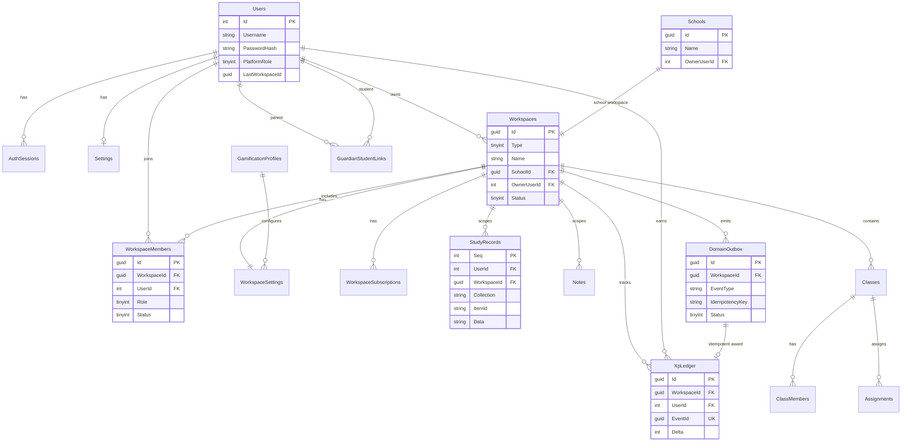

# Entity Relationship Diagram

Logical ER for the target design. Existing tables marked with `*`.

## Overview (Mermaid)

## Relationship rules

1. `Users 1—* AuthSessions*` (existing)
2. `Users 1—0..1 Settings*` (legacy personal settings during transition)
3. `Users 1—1 Personal Workspace` (enforced by unique filtered index)
4. `Schools 1—1 School Workspace`
5. `Workspaces 1—* WorkspaceMembers`
6. `Workspaces 1—* StudyRecords*` (after backfill)
7. `Workspaces 1—* Notes*/NoteFolders*/…` (after backfill)
8. `DomainOutbox 1—0..1 XpLedger` via unique `EventId`
9. School instructional graph hangs under School Workspace only

## Index highlights

| Table | Index |
| --- | --- |
| Workspaces | UX_PersonalOwner (`OwnerUserId`) WHERE Type=Personal AND DeletedAt IS NULL |
| Workspaces | UX_School (`SchoolId`) WHERE Type=School |
| WorkspaceMembers | UX_Member (`WorkspaceId`,`UserId`) WHERE DeletedAt IS NULL |
| StudyRecords | IX (`WorkspaceId`,`Collection`,`Seq`) |
| DomainOutbox | UX (`WorkspaceId`,`EventType`,`IdempotencyKey`) |
| DomainOutbox | IX Pending (`Status`,`NextAttemptAt`) |
| XpLedger | UX (`EventId`) |
| UserGameStats | PK (`WorkspaceId`,`UserId`) |

## Soft-delete visibility

Application queries default to `DeletedAt IS NULL`. Platform admin tools may include deleted rows explicitly.
